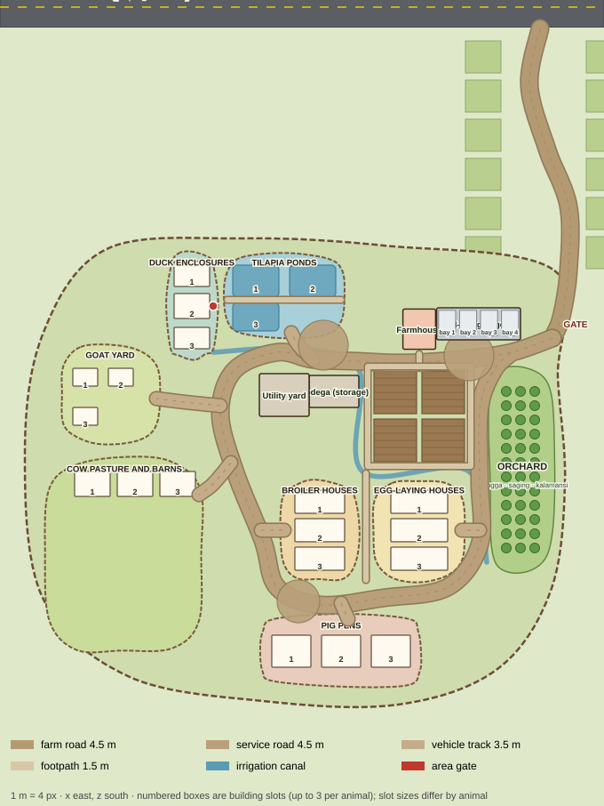

# Sunfield Farm — revised farm masterplan (revision 2)

This replaces the farm part of [masterplan.md](masterplan.md). Nothing has been moved in the game yet; this is the plan to approve first.

The map is drawn by `node docs/build-farm-plan.js` straight from the `FARM` layout block in `public/index.html`, so the plan and the game use one set of numbers.

## 1. What is there today (inspected)

| Thing | Today | Problem against the reference |
|---|---|---|
| Lot | rectangle x −48…32.5, z −32.6…19.5 (80 × 52 m) | too small and boxy for separate animal areas |
| Animals | one shared grid (*bakuran*), 18 × 8 plots of 2 m, every building a 3 × 3 block (6 × 6 m), placed by the player | all animal houses touch each other; every type is the same size |
| Farm road | straight: x 5→34 along z −14.5, then dead straight 90 m north to the highway | right-angle, schematic |
| Field | 12 × 12 plots (24 × 24 m) at the origin | one solid block, no tracks |
| Garage | 23.4 × 7.6 m, 4 bays | close, but the bays are shallow for the Elf truck and van |
| People | the farmer and helpers walk in straight lines to any job | would walk through new fences |

Coordinates: metres, **x east, z south**, origin at the middle of today's field; the highway runs along z = −110. The vehicles measure: sedan 4.4 × 1.8 m, jeepney about 5.8 m, Elf truck and closed van about 6.5 m long.

## 2. The new layout

The lot grows to about **150 × 130 m** (x −111…41, z −45…86) behind an irregular fence, all on land that is empty today. The farmhouse and garage stay by the entrance. Working areas fan out behind them along one dirt service road.

| Area | Where (centre) | Footprint | Notes |
|---|---|---|---|
| Gate | (38.6, −17) | 6 m wide | on the east fence where the farm road arrives |
| Farmhouse | (0, −19.5) | 9.2 × 11.3 m lot | unchanged, still movable |
| 4-bay garage | (16.7, −21) | 23.6 × 9 m | **4 bays of 5.6 × 8.5 m** side by side, concrete floor, GI roof on columns, **9 m shared apron** with a 7 m turning circle (fits the truck and van) |
| Bodega (storage) | (−24, −2) | 14 × 9 m | next to the service road with a 7 m turning yard for loading harvest and feed |
| Utility yard | (−38, −1) | 14 × 12 m | water tower, workshop, kuliglig shed |
| Crop field | (0, 5) | 25.5 × 25.5 m | the same 144 plots, laid out as **4 beds of 6 × 6** with 1.5 m soil tracks between them and a footpath round them; irrigation canal along the south side |
| Orchard | east boundary, x 20…38, z −6…47 | about 16 × 50 m | along the fence, beside the service road |
| Egg-laying houses | (0, 37) | area 24 × 26 m | 3 slots of **16 × 6.5 m** long houses, 1.5 m paths between them |
| Broiler houses | (−28, 37) | area 20 × 26 m | 3 slots of **14 × 6.5 m**; 6 m green buffer and a footpath from the egg houses |
| Cow pasture and barns | (−83, 44) | area 42 × 52 m | open pasture, 3 barn slots of **10 × 7 m** along the north side |
| Goat yard | (−87, −1) | area 26 × 26 m | 3 slots of **7 × 5 m** goat houses on stilts |
| Pig pens | (−22, 71) | area 44 × 18 m | 3 slots of **11 × 9 m** (shelter and outdoor pen), farthest from the house, downwind |
| Tilapia ponds | (−38, −29) | area 32 × 22 m | 3 earthen ponds of **13 × 9 m** with dikes; aerators and a feeding platform |
| Duck enclosures | (−64, −26) | area 12 × 28 m | 3 slots of **10 × 7 m** (shelter, run and a small pond), beside the fish ponds |

## 3. Roads and paths

Every road is a smooth curve (a Catmull-Rom spline through the points in the `FARM` layout), built as one continuous strip that follows the ground. It has wheel ruts, gravel and grass shoulders, and slightly ragged edges.

| Road | Width | Route |
|---|---|---|
| Farm road | 4.5 m | highway junction (34, −104) → a gentle S through the paddies → gate (37.5, −17). Vehicles drive it. |
| Main service road | 4.5 m | gate → garage apron → past the house and field → bodega yard → bends round the utility yard and duck area → down the west side → feed drop (−34, 57) → back up the east side between the field and orchard to the garage apron |
| Vehicle tracks | 3.5 m | short spurs to each animal-area gate: tilapia (−36, −18.5), goats (−74, 0), cows (−62, 27), broilers (−38, 37), egg houses (12, 37), pigs (−20, 62) |
| Footpaths | 1.5 m | round the field beds, between the egg and broiler areas, along the pond dike, house to road |
| Turning areas | r 6–8 m | garage apron (14, −12), bodega yard (−27, −15), feed drop (−34, 57) |

**Navigation access points:** each area has one gate on its vehicle track, and each building slot has a work spot just inside its door. The farmer and helpers will walk along a network of these roads, tracks and paths: nearest point, then the shortest route, then the gate, then the work spot. They won't cut through fences. Your vehicles use the farm road between the garage and the highway, as now.

## 4. Fit check

- Everything sits inside x −111…41, z −45…86. Today that is open countryside with random trees, the carabao and some low decorative hills; the hills south of z 70 move further out.
- The highway, paddies, sari-sari store, bus stop and town are untouched. The farm road junction stays at x 34 on the highway.
- Camera limits (up to 85 m out) cover the whole farm.

## 5. Keeping saved progress (migration)

- **Crop field:** the same 144 plots with the same save indexes. Only where each plot is drawn changes (+5 m south, gaps between beds). Crops, timers and soil carry over untouched.
- **Animal buildings:** the shared yard grid is retired. Each animal area gets 3 numbered slots, stored in the existing save array. On first load, every building in the old yard moves to the next free slot of its type, keeping its **level, timers, feed and stored goods**. The old "occupied" filler plots are cleared.
- **House and garage:** stay where they are if they fit the new home area, otherwise they go back to the default spots.
- **Bodega drop-off point:** moves to the new bodega door. Anything already stored is unaffected.
- **Building new ones:** picking an animal building in Build puts it in the next free slot of its area, or you can tap an empty slot's sign. The per-level limits (up to 3 of each) stay the same.

## 6. Building it in stages (each with in-game screenshots)

1. Layout config in the game, the new lot fence, spline roads and the moved farm road (vehicles retested).
2. Field beds with tracks and canal; bodega, utility and orchard placement.
3. The slot system and the save migration, plus the build and tap flow (tested with an old save that has a full yard).
4. New animal buildings at their own sizes, styled after the reference: long open poultry houses, a cow barn with pasture, pig shelter and pens, duck shelter and run, tilapia ponds with aerators and a dock.
5. Walking on the path network for the farmer and helpers.
6. Mountain barangay: contour-following winding roads, clusters of houses at junctions, terraces.
7. Town: small streets, parking and pedestrian lanes round the palengke.
