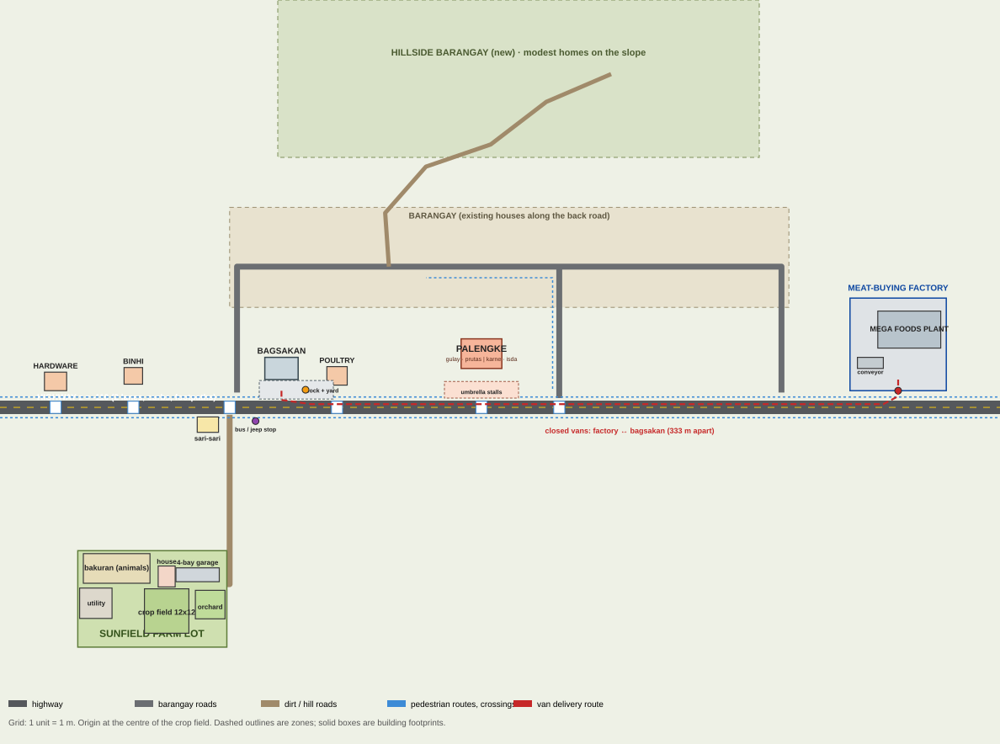

# Sunfield Farm world masterplan

Coordinates are the game's own world units (1 unit ≈ 1 m): **x runs east, z runs south**, the origin is the centre of the crop field, and the highway runs east–west along **z = −110**. The map below is generated from these numbers ([masterplan.svg](masterplan.svg)).

## Locations and footprints

| Area | Centre (x, z) | Footprint | Notes |
|---|---|---|---|
| Farm lot | (−8, −6) | x −48…32.5, z −32.6…19.5 | fenced; SUNFIELD FARM gate on the east side at z −14.5 |
| Crop field | (0, 0) | 24 × 24 (12 × 12 plots of 2 m) | tiles `0…143` in the save |
| Bakuran (animal yard) | (−27, −23) | x −45…−9, z −31…−15 (18 × 8 plots) | pasture / babuyan + palaisdaan / manukan zones |
| Farmhouse | (0, −20) default | 9.2 × 11.3 lot | one modest house with a veranda (no upgrades); player can move it (`S.housePos`) |
| 4-bay garage | (16.7, −19.5) default | 23.4 × 7.6 | player can move it (`S.garagePos`); bays at −8.25, −2.75, 2.75, 8.25 |
| Orchard | (23.5, −3.5) | x 15.5…31.5, z −11.2…4.2 | decorative |
| Utility yard | (−38, −4) | x −47…−29.5, z −12.4…4 | water tower, talyer, feed bodega, kuliglig shed |
| Sari-sari store | (22, −100) | x 16.5…28, z −104.8…−96.5 | at the farm-road junction |
| Binhi at Abono | (−18, −127) | 10 × 9 | shop menu `STORE.seeds` |
| Mabuhay Hardware | (−60, −124) | 12 × 10 | shop menu `STORE.hardware` |
| Agrivet & Poultry Supply | (92, −127) | 11 × 10 | shop menu `STORE.poultry` |
| Palengke (Pamilihang Bayan) | (170, −139) | hall 22 × 16 (x 159…181, z −147…−131), apron to the highway | dry side: vegetable and fruit rows; wet side behind a low tiled wall: meat and fish counters; umbrella stalls outside, kargador, tricycle terminal |
| Bagsakan (warehouse) | (62, −131) | shed 18 × 12; yard x 50…90, z −124.5…−114.5 | one unloading bay at (75, −119.5); van docks at x 56, 62, 68 |
| Mega Foods (meat-buying factory) | (395, −144) | compound x 369…421, z −169…−119 | gate (395, −119); plant x 384…418; conveyor shed (380, −134); vans park at z −135 |
| Barangay | (185, −191) | x 34…336, z −218…−164 | houses along the back road z −186; park at (88, −203) |
| Hillside barangay (new) | (190, −285) | x 60…320, z −330…−245 | modest homes on a slope, reached by a dirt road from the back road |
| Bus / jeepney stop | (48, −102.6) | bay at z −105.5 | |

## Roads

| Road | Route | Width |
|---|---|---|
| Highway | x −850…850 at z −110; lanes at z −111.75 (west) and −108.25 (east) | 7.2 m asphalt, low curbs, 1.4 m footpaths both sides |
| Farm road (dirt) | gate (32.5, −14.5) → (34, −14.5) → north along x = 34 → highway | 3.2 m |
| Barangay roads | west road x 38.25, east road x 331.75, back road z −186, side street x 212 | 6 m |
| Hillside road (new, dirt) | from the back road at (120, −186) winding up to (240, −290) | 3 m |

## Loading areas and the delivery chain

**Farm → Bagsakan → closed vans → Mega Foods.**

1. Your vehicle leaves the garage, takes the farm road to the highway and turns into the bagsakan yard; it backs into the bay at (75, −119.5).
2. Three closed vans wait at the factory (z −135). When the bagsakan has goods, a van drives out of the gate, west on lane z −111.75, and backs into a dock at x 56 / 62 / 68 (z −119.6).
3. Kargador carry boxes from the dock doors (z −14.2 in front of the shed) into the van; the van drives back east on lane z −108.25 and unloads at the plant.
4. The factory conveyor runs only while a van unloads and for about 24 s after.

The bagsakan and the factory are **333 m apart** and share no compound.

## Pedestrian routes

- Footpaths on both sides of the highway (z −104.4 and −115.6) with zebra crossings at x −60, −18, 34, 92, 170 and 212.
- Palengke shoppers walk from barangay houses down the side street (x ≈ 208) to the highway footpath, into the two aisles (dry goods at x 164.25, wet section at x 175.75), cross behind the stalls and walk back.
- Bus and jeepney riders walk between the stop at (48, −102.6) and town.

## What does not move

Every position above that a save, a route or a shop depends on (field and yard tiles, house and garage, store menus, the bagsakan bay, van docks, factory gate, bus stop, walker routes) stays where it is. The redesign changes how these places look and adds new scenery only where nothing is built.
